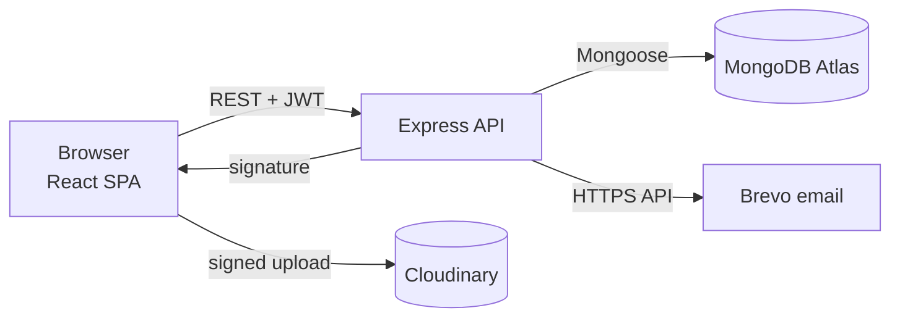

<div align="center">


# ParamPara · परम्परा

**A private family heritage platform: build your family tree, preserve the stories behind old photos, recipes and traditions, and share them with relatives.**

[](https://parampara-web.onrender.com)
[](https://parampara-api-b1s0.onrender.com/api-docs)


[Live demo](https://parampara-web.onrender.com) · [Features](#features) · [Tech stack](#tech-stack) · [Getting started](#getting-started) · [API](#api-overview) · [Deployment](#deployment)

</div>

---


## Why ParamPara

Every family has stories that live only in someone's memory: the recipe only Dadi knows, the diary Dada ji kept for forty years, the faces in an old photo nobody can name anymore. ParamPara gives a family one private place to record them, linked to the people they are about, so they reach the next generation.

> **Note:** the API runs on Render's free plan and sleeps after 15 minutes without traffic. The first request after that takes about a minute; the app shows a "Waking up the server" banner while it waits.

## Features

**Family tree**
- Add relatives with or without an account: name, nickname ("Dadi", "Chacha ji"), gender, birth and death dates, birthplace, photo and bio
- Parent, child, spouse and sibling relationships, with checks against duplicates and contradictions
- Tree drawn with connecting lines: couples side by side, children below, generations worked out on the server
- A profile page for every person, with their relatives in plain words ("mother", "son") and the memories they appear in

**Memories**
- Stories, recipes, letters, photographs, family events, traditions and achievements
- Tag the people in each memory; filter by person, category or text, sorted and paginated
- Year-by-year timeline of dated memories
- Comments on every memory

**Sharing and roles**

| Role | Can do |
|---|---|
| **Owner** | Everything, including sharing, changing roles, exporting and deleting the family |
| **Editor** | Add and edit people, relationships and memories |
| **Viewer** | Read everything and comment (good for elders who just want to follow along) |

- Single-use invite links that expire after 7 days, with a WhatsApp share button
- Add existing users by email, change roles, remove access
- Activity feed of who added what

**Accounts and data**
- Signup, login, forgot/reset password by email
- Changing the password or "Log out everywhere" ends all other sessions immediately
- Delete account (families you own are deleted; memories you wrote in other families stay)
- Export a whole family (people, relationships, memories, comments) as JSON

**Photos**
- Direct browser-to-Cloudinary uploads signed by the server, so images never pass through the API
- Thumbnails requested at display size; pasted photo links still work when uploads are not set up


## Tech stack

| Layer | Technology |
|---|---|
| **Frontend** | React 19, Vite, Tailwind CSS 4, React Router 7, Axios |
| **Backend** | Node.js, Express 5, Mongoose 9, Zod |
| **Database** | MongoDB Atlas (transactions used for multi-step deletes) |
| **Auth & security** | JWT with token versioning, bcrypt, Helmet, express-rate-limit, CORS allow-list |
| **Media & email** | Cloudinary (signed direct uploads), Brevo HTTPS API (password reset) |
| **Testing** | Jest, Supertest, mongodb-memory-server (53 tests) |
| **Docs** | OpenAPI 3 / Swagger UI at `/api-docs` |
| **Hosting** | Render: free web service (API) and static site (frontend) |

## Architecture



The backend is a layered monolith: each request goes through the route, then Zod validation, JWT auth, the controller, the service (business rules) and finally the model. Every family-scoped route goes through a single access check, `getFamilyForUser(id, user, { write, ownerOnly })`, so role rules live in one place.

Design notes and trade-offs: [`backend/DESIGN.md`](backend/DESIGN.md).

## Project structure

```
.
├── backend/
│   ├── src/
│   │   ├── config/        # env validation, DB connection
│   │   ├── routes/        # URL → middleware → controller
│   │   ├── validators/    # Zod schemas (unknown fields dropped)
│   │   ├── middleware/    # auth, validation, request id, errors
│   │   ├── controllers/   # HTTP in/out only
│   │   ├── services/      # access, tree, invitations, email, uploads, activity
│   │   ├── models/        # User, Family, FamilyMember, Relationship, Memory, Comment, Activity, Invitation
│   │   └── docs/          # OpenAPI spec
│   ├── scripts/seed.js    # demo data
│   └── tests/             # Jest + Supertest
├── frontend/
│   └── src/
│       ├── components/    # UI kit, LineageTree, PhotoInput, Confirm dialog
│       ├── pages/         # lazy-loaded pages
│       └── api.js         # Axios client, auth + "waking up" handling
├── render.yaml            # Render Blueprint (API + website)
└── DEPLOY.md              # free hosting guide
```

## Getting started

### Prerequisites
- Node.js **20.19+**
- A MongoDB connection string: a free [MongoDB Atlas](https://www.mongodb.com/cloud/atlas/register) cluster, or a local MongoDB

### 1. Clone
```bash
git clone https://github.com/ohathena/ParamPara-Family-Memory-Reservoir.git
cd ParamPara-Family-Memory-Reservoir
```

### 2. Backend
```bash
cd backend
npm install
cp .env.example .env      # then fill in MONGO_URI and JWT_SECRET
npm run seed              # optional: demo family with sample data
npm run dev               # http://localhost:5000  (Swagger at /api-docs)
```

### 3. Frontend (new terminal)
```bash
cd frontend
npm install
npm run dev               # http://localhost:5173
```
In development, Vite proxies `/api` to `http://localhost:5000`.

### Demo accounts (after `npm run seed`)
Password for all: `password123`

| Email | Role |
|---|---|
| `demo@parampara.com` | Owner |
| `priya@parampara.com` | Editor |
| `nanaji@parampara.com` | Viewer |

## Environment variables

`backend/.env`. See [`backend/.env.example`](backend/.env.example) for the full list.

| Variable | Required | Description |
|---|---|---|
| `MONGO_URI` | ✅ | MongoDB connection string |
| `JWT_SECRET` | ✅ | Long random string (32+ characters in production) |
| `CLIENT_URL` | ✅ | Frontend URL(s), comma-separated, used for CORS |
| `JWT_EXPIRES_IN` | | Token lifetime, default `7d` |
| `NODE_ENV` / `TRUST_PROXY` | | `production` / `true` when hosted behind a proxy |
| `EMAIL_PROVIDER`, `EMAIL_API_KEY`, `MAIL_FROM` | | `brevo` or `resend`, for password-reset email |
| `CLOUDINARY_CLOUD_NAME`, `CLOUDINARY_API_KEY`, `CLOUDINARY_API_SECRET` | | Enables photo uploads |

Optional features switch themselves on when their keys are present. The frontend reads `GET /api/config` and hides what isn't available.

## Scripts

| Location | Command | What it does |
|---|---|---|
| backend | `npm run dev` | Start the API with auto-reload |
| backend | `npm start` | Start the API (production) |
| backend | `npm test` | Run the 53 tests on a temporary database |
| backend | `npm run seed` | Load demo data (refuses to run in production) |
| frontend | `npm run dev` | Start the dev server |
| frontend | `npm run build` | Production build to `dist/` |
| frontend | `npm run lint` | Lint with oxlint |

## API overview

All routes are under `/api`. Everything except auth, config and health needs `Authorization: Bearer <token>`. The full interactive reference is at **`/api-docs`**.

| Area | Endpoints |
|---|---|
| Auth | `POST /auth/register` · `POST /auth/login` · `GET/PATCH/DELETE /auth/me` · `POST /auth/change-password` · `POST /auth/logout-all` · `POST /auth/forgot-password` · `POST /auth/reset-password` |
| Families | `GET/POST /families` · `GET/PATCH/DELETE /families/:id` · `DELETE /families/:id/leave` |
| Sharing | `POST /families/:id/collaborators` · `PATCH/DELETE /families/:id/collaborators/:userId` · `POST /families/:id/invitations` · `GET /invitations/:token` · `POST /invitations/:token/accept` |
| People | `GET/POST /families/:id/members` · `GET/PATCH/DELETE /members/:id` |
| Relationships | `POST /relationships` · `PATCH/DELETE /relationships/:id` · `GET /families/:id/relationships` |
| Memories | `GET/POST /memories` · `GET/PATCH/DELETE /memories/:id` |
| Comments | `GET/POST /memories/:id/comments` · `DELETE /comments/:id` |
| Views | `GET /families/:id/tree` · `/timeline` · `/stats` · `/activity` · `/export` |
| Uploads | `POST /uploads/signature` |
| Platform | `GET /health` · `GET /health/ready` · `GET /config` |

## Testing

```bash
cd backend
npm test
```
- 53 integration tests (Jest + Supertest) cover auth, sessions, password reset, roles, access control (401/403/404/409), relationships, memories, comments, activity, export, uploads and account deletion.
- By default the tests start a temporary in-memory MongoDB and never touch your real database.
- To use your own test server instead, run `TEST_MONGO_URI=mongodb://127.0.0.1:27017 npm test`.

## Security

- Passwords hashed with bcrypt, using a constant-time path for unknown emails
- JWTs carry a token version, so password change, password reset and "log out everywhere" revoke old sessions at once
- Reset and invite tokens are random, single-use and time-limited; only their SHA-256 hashes are stored
- Zod validation on every input drops unknown fields (no mass assignment); IDs are checked; regex search input is escaped
- Role checks happen on the server for every family-scoped route
- Helmet headers, CORS allow-list, global and per-route rate limits, 100 kB body limit
- Unknown errors return a request id; details stay in server logs

## Deployment

The project deploys for free with a Render Blueprint (`render.yaml`): the API on a free web service, the website on a static site, and the database on a MongoDB Atlas free cluster.

Step-by-step guide, including MongoDB Atlas, Cloudinary, Brevo, custom domains and troubleshooting: **[DEPLOY.md](DEPLOY.md)**

> The production API URL is set in `frontend/src/api.js`. Update it there if the API address changes.

## Roadmap

- [ ] Delete Cloudinary images when a memory or person is removed
- [ ] Multiple photos per memory (albums)
- [ ] Hindi interface
- [ ] Email notifications for new memories and comments
- [ ] GEDCOM import/export for genealogy tools

## Contributing

Issues and pull requests are welcome. Please run `npm test` (backend) and `npm run lint && npm run build` (frontend) before opening a PR.

## License

Released under the [MIT License](LICENSE).

## Author

**Ansh Khajuria**. Built to keep family stories alive.
